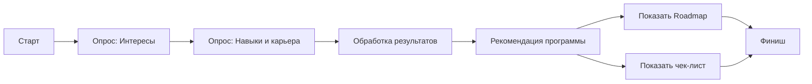

# Путь в профессию: Найди свою программу в ИРИТ-РТФ

---

## О проекте

**«Путь в профессию»** — это интерактивный веб-сервис, созданный для абитуриентов и первокурсников, которые хотят осознанно выбрать направление обучения в ИРИТ-РТФ (УрФУ). Вместо изучения сложных текстов на сайте вуза, мы предлагаем пройти короткий квиз, чтобы понять свои интересы, увидеть карьерные треки и получить персонализированный план действий.

### Проблема
Абитуриенты теряются при выборе направления: не видят отличий между специальностями, не понимают, где больше программирования, а где — работы с «железом», и делают выбор вслепую. Стандартные описания на сайте кажутся сложными и неинтересными, что приводит к разочарованию на первых курсах.

### Решение
Сервис анализирует профиль пользователя через короткий опрос и:
1. **Рекомендует** 1–2 подходящих направления бакалавриата ИРИТ-РТФ.
2. **Обосновывает** выбор простыми и понятными словами.
3. **Строит Roadmap** — визуальный план обучения на 4 года с ключевыми курсами, навыками и стажировками.
4. **Дает чек-лист** «Миссия до 1 сентября» для мягкого погружения в профессию.

---

## Содержание
- [Основные функции](#основные-функции)
- [Как это работает](#как-это-работает)
- [Технологии](#технологии)
- [Установка и запуск](#установка-и-запуск)
- [Данные и границы](#данные-и-границы)
- [План развития](#план-развития)
- [Команда](#команда)

---

## Основные функции

### 1. Интерактивный квиз-навигатор
Пользователь проходит короткий опрос, который выявляет его интересы, предпочитаемые школьные предметы, тип мышления и карьерные цели. Вопросы оформлены в виде выбора картинок и ситуаций, что делает процесс легким и увлекательным.

### 2. Персональная рекомендация
На основе ответов система подбирает 1-2 направления из ИРИТ-РТФ (например, «Прикладной искусственный интеллект» или «Радиотехника») и дает понятное обоснование: «Почему это тебе подходит».
ируется план обучения по годам с ключевыми курсами, приобретаемыми навыками и возможными стажировками у партнеров УрФУ.

### 4. Чек-лист «Миссия до 1 сентября»
Пользователь получает список из 3-5 конкретных шагов, которые можно сделать уже сейчас: пройти курс на Stepik, собрать схему на Arduino или прочитать книгу. Это помогает начать погружение в профессию до старта учебы.

---

## Как это работает

1. **Старт** — пользователь попадает на главную страницу.
2. **Опрос** — последовательно отвечает на вопросы по разделам: "Интересы", "Навыки и карьера".
3. **Результат** — система обрабатывает ответы и выдает рекомендацию с обоснованием.
4. **План действий** — пользователь видит свой Roadmap и чек-лист подготовки.

---

## Технологии

- **Frontend**: HTML5, CSS, JavaScript (чистый код, без фреймворков)
- **Хостинг**: GitHub Pages
- **Структура**: Одностраничное приложение (SPA) с адаптивным дизайном
- **Управление версиями**: Git, GitHub
- **Среда разработки**: Любой современный браузер и текстовый редактор

---

## Установка и запуск

Это статическое веб-приложение, для работы которого достаточно перейти по [прямой ссылке](https://0sova.github.io/PathToTheProfession/).

---

## Данные и границы

- **Откуда данные:** Описание образовательных программ, курсов и партнеров основаны на информации с официального сайта УрФУ и открытых источников.
- **При отсутствии данных:** Если по какой-то причине данные о программе недоступны (например, нет информации о партнерах), система честно отображает сообщение: *«нет данных»* или *«информация обновляется»*.
- **Ограничения:** Прототип использует демо-данные для демонстрации логики. В реальной версии необходима интеграция с API вуза.
- **Границы применимости:** Сервис ориентирован на различных направлениях ИРИТ-РТФ. Для других институтов требуется доработка базы знаний.

---

## План развития

- [ ] **Интеграция с API 1С УрФУ** для получения актуальных данных о программах, курсах и партнерах в реальном времени.
- [ ] **Добавление личных кабинетов** с сохранением результатов, историей прохождений и возможностью сравнивать направления.
- [ ] **Расширение базы направлений** и добавление информации о магистерских программах.
- [ ] **Интеграция отзывов** от студентов и выпускников для каждого направления.

---

## Благодарности

- ИРИТ-РТФ УрФУ за предоставленные материалы и поддержку.
- Всем тестировщикам, которые помогли выявить баги и улучшить сервис.
- Наставникам и менторам за ценные советы и направление.

---

**Сделано с ❤️ для абитуриентов, которые ищут свой путь.**
